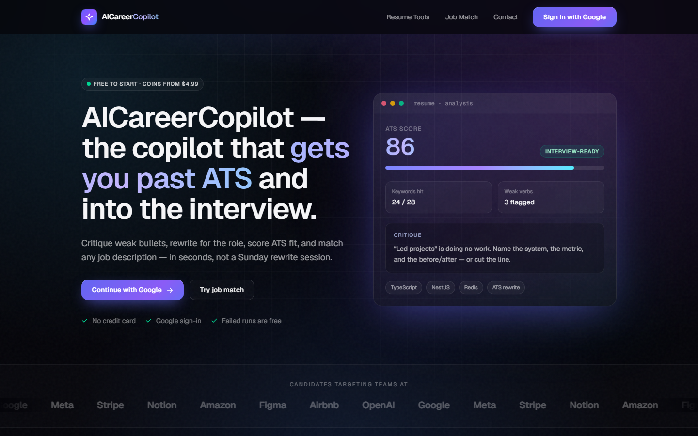
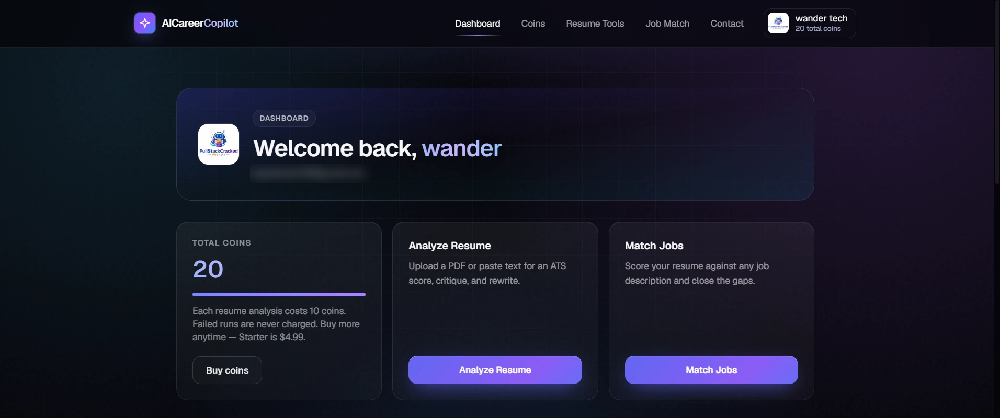
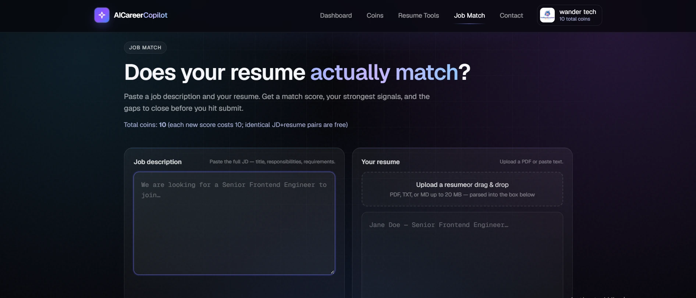
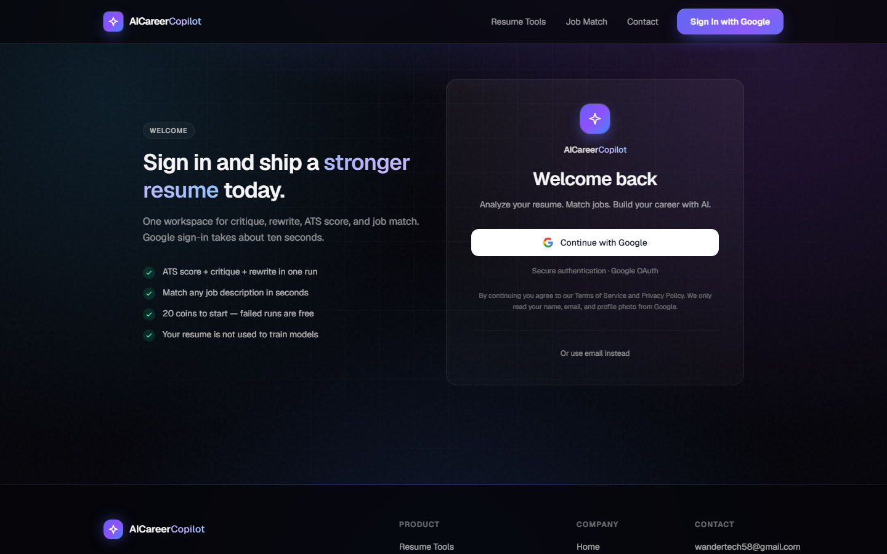
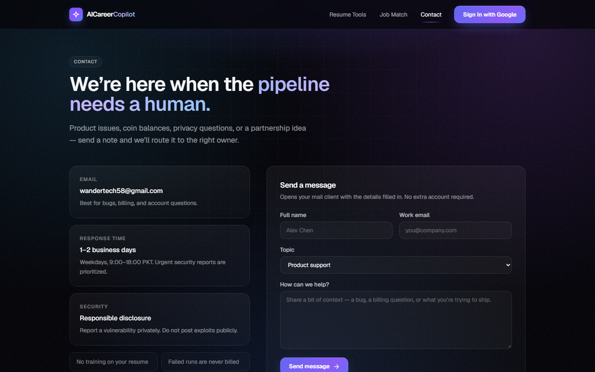
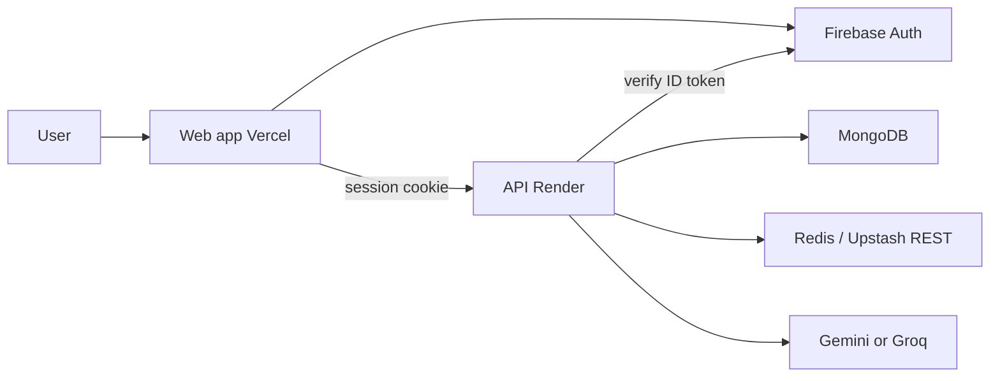

<div align="center">

# AICareerCopilot

**Get past ATS and into the interview.**
Critique your resume, rewrite it for the role, and score it against any job description, in seconds.

[](https://ai-career-copilot-hazel.vercel.app)




</div>

A full-stack AI SaaS for job seekers: Firebase accounts, a usage-coin system, LLM pipelines (Gemini / Groq) orchestrated with LangGraph, and a production deploy on Vercel + Render.

> **This is the open-source showcase edition.** It contains the full product UI, auth, coins, resume analysis and job match. A few premium modules run only in the [hosted app](https://ai-career-copilot-hazel.vercel.app) and are not included here (see [What's included](#whats-included)).

| | |
|---|---|
| **Live app** | [ai-career-copilot-hazel.vercel.app](https://ai-career-copilot-hazel.vercel.app) (free 20 coins on sign-up) |
| **API health** | [ai-career-copilot-7iee.onrender.com/api/v1/health](https://ai-career-copilot-7iee.onrender.com/api/v1/health) |
| **Support** | [wandertech58@gmail.com](mailto:wandertech58@gmail.com) · [/contact](https://ai-career-copilot-hazel.vercel.app/contact) |

> The API runs on Render's free tier, so the first request after a quiet period can take ~30–60 seconds while it wakes up.

---

## Screenshots

| Dashboard | Job match |
|---|---|
|  |  |
| **Sign in** | **Contact** |
|  |  |

---

## What's included

| Feature | This repo | [Hosted app](https://ai-career-copilot-hazel.vercel.app) |
|---|:---:|:---:|
| Next.js product UI (landing, dashboard, resume, job match, contact) | ✅ | ✅ |
| Firebase auth (Google + email/password, account linking), HTTP-only sessions | ✅ | ✅ |
| Users, coin balance, charge-on-success + refunds | ✅ | ✅ |
| Resume analysis pipeline (LangGraph: extract → analyze → validate/retry → ATS → recommendations) | ✅ | ✅ |
| Job match with evidence-weighted scoring and content-hash cache | ✅ | ✅ |
| Gemini / Groq / mock LLM providers | ✅ | ✅ |
| Labor-market **RAG** (Qdrant retrieval injected into prompts) | — | ✅ |
| **Background job queue** for resume analysis (BullMQ workers) | — | ✅ |
| **Stripe Checkout** coin packs + signed webhook ledger | — | ✅ |

In this build, the RAG service is a stand-in that returns empty context, resume analysis always runs inline, and the Coins page links to the hosted app for purchases.

---

## Problem

Job seekers rewrite resumes in the dark: generic ChatGPT output, no ATS signal, no proof they match a specific posting. Hiring software still filters on keywords and structure. Candidates need **role-specific** feedback tied to **their** document, not a generic essay.

## Solution

AICareerCopilot is a **usage-based SaaS workspace**:

1. Sign in (Google or email).  
2. Analyze a resume (PDF or paste).  
3. Match it to a real job description.  
4. Pay in **coins** only when a run succeeds.

Identity is one Firebase user, one Mongo profile, one coin balance. Google and password can be linked on the same account; emails are never auto-merged.

---

## Product surface

| Module | What the user gets |
|--------|-------------------|
| **Dashboard** | Coins, shortcuts to resume and job match |
| **Resume analysis** | ATS notes, critique, strengths/gaps, rewrite direction, parsed profile |
| **Job match** | Fit score, missing requirements, bullets that close gaps |
| **Account** | Linked sign-in methods (Google / email-password), coins |
| **Billing** | Coin pack pricing (Starter $4.99 / Plus $14 / Pro $29.99); purchases run in the hosted app |
| **Contact** | Support mailto |

**Metering:** 20 coins on signup · 10 coins per successful analysis · 0 on failure · cached identical job-match is free.

---

## Customer journey

```text
Land → Sign in
         │
         ▼
    Dashboard (20 coins)
         │
         ├─ Resume  →  PDF/text + optional target role
         │              critique · ATS · rewrite
         │
         ├─ Job match  →  JD + resume
         │              score · gaps · tailored bullets
         │
         └─ Billing →  Starter $4.99 / Plus $14 / Pro $29.99
         │
         ▼
    Copy output → apply
```

Password reset and email verification are handled by Firebase (link in email, then return to the app).

---

## How the platform works



### Auth and tenancy

- Client signs in with Firebase; browser sends **ID token only**.  
- API verifies with Firebase Admin, then `findOrCreate` Mongo by **`firebaseUid`**.  
- Session is an **HTTP-only cookie** (Redis/Upstash). No session id in `localStorage`.  
- Coins live on the user document; the client cannot pick another UID.

### Resume pipeline

Extract text → normalize → LLM analyze → validate/retry → ATS → recommendations → **charge 10 coins** → persist.

### Job match pipeline

Content-hash cache (hit = free) → structured LLM → **evidence-weighted score in code** → charge → persist.

The headline match % is finalized from requirement evidence (`job-match.score.ts`), not a raw model guess.

---

## Stack (portfolio)

| Layer | Choice |
|-------|--------|
| Product UI | Next.js, static export, Vercel |
| API | NestJS, Docker, Render |
| Auth | Firebase (Google + email/password + linking) |
| Data | MongoDB Atlas (users, analyses) |
| Session / cache | Redis (local) or Upstash Redis REST |
| AI | Gemini or Groq; LangGraph-style resume graph |
| Testing | Jest (API), Vitest + Testing Library (UI), GitHub Actions CI |

---

## Pricing

Pay per successful run, not a monthly seat. New accounts start with **20 coins**. Each successful resume analysis or new job match costs **10 coins**. Failed runs and cached identical job matches are free.

In the hosted app, more coins can be bought as one-time packs on [/billing](https://ai-career-copilot-hazel.vercel.app/billing). Payments are not part of this repo.

### Usage meter

| Event | Coins |
|-------|-------|
| New account | +20 |
| Successful resume analysis | −10 |
| Successful job match (new JD + resume pair) | −10 |
| Failed run | 0 |
| Repeat job match (same content hash) | 0 |

### Coin packs

| Pack | Coins | Price | Roughly |
|------|-------|-------|---------|
| Starter | 50 | **$4.99** | ~5 runs |
| Plus (popular) | 200 | **$14.00** | ~20 runs |
| Pro | 500 | **$29.99** | ~50 runs |

---

## Trust

Resumes are used to generate **that user’s** results, not to train public models in this product. Passwords never touch MongoDB. Production cookies are `SameSite=None` + HTTPS so Vercel can talk to Render.

---

## Run locally

### Prerequisites

- **Node.js 20+** and npm
- **Docker** (runs MongoDB and Redis locally)
- A free **Firebase** project, for sign-in
- *Optional:* a **Groq** or **Gemini** API key for real AI output. Without one, the backend uses a mock LLM (`LLM_PROVIDER=mock`).

### 1. Clone and install

```bash
git clone https://github.com/Qursom/ai-career-copilot-showcase.git
cd ai-career-copilot-showcase
npm run install:all
```

### 2. Start the local databases

```bash
docker compose up -d
```

This starts MongoDB (`27017`) and Redis (`6379`).

### 3. Set up Firebase

1. In the [Firebase console](https://console.firebase.google.com), create a project.
2. Go to **Authentication → Sign-in method** and enable **Google** and **Email/Password**.
3. Go to **Project settings → General**, add a **Web app**, and copy its config values for the frontend.
4. Go to **Project settings → Service accounts → Generate new private key**. Save the file in the repo root as `firebase-adminsdk.json` (it's git-ignored).

### 4. Create the env files

```bash
cp backend/.env.example backend/.env
cp frontend/.env.example frontend/.env.local
```

Fill in at least:

| File | Variable | Value |
|------|----------|-------|
| `backend/.env` | `MONGODB_URI` | `mongodb://localhost:27017/career_copilot` |
| `backend/.env` | `REDIS_URL` | `redis://localhost:6379` |
| `backend/.env` | `FIREBASE_SERVICE_ACCOUNT_PATH` | `../firebase-adminsdk.json` (or set `FIREBASE_PROJECT_ID` / `FIREBASE_CLIENT_EMAIL` / `FIREBASE_PRIVATE_KEY`) |
| `backend/.env` | `LLM_PROVIDER` + `GROQ_API_KEY` or `GEMINI_API_KEY` | Optional, for real AI output |
| `frontend/.env.local` | `NEXT_PUBLIC_API_URL` | `http://localhost:3001/api/v1` |
| `frontend/.env.local` | `NEXT_PUBLIC_FIREBASE_*` | Values from your Firebase web app config |

Sentry is optional. The app runs without it.

### 5. Run it

```bash
npm run dev
```

- App: http://localhost:3000
- API: http://localhost:3001 (health check: `/api/v1/health`)

### Tests

```bash
npm test
```

```bash
npm --prefix frontend test
```

Never commit real secrets, `.env` files or `firebase-adminsdk.json`.

**Production:** Vercel (`NEXT_PUBLIC_API_URL`, Firebase public config) + Render (`CORS_ORIGIN` / `FRONTEND_URL` = exact UI origin, Mongo, Upstash REST, LLM keys, Firebase Admin). `render.yaml` is a ready-made Blueprint for the API.

---

## API (authenticated unless noted)

`/api/v1` — `POST /auth/login` `{ idToken }` · `GET /auth/me` · `POST /auth/logout` · `GET /health` · resume analyze/upload/extract · `POST /job-match/score` · job-match history. Swagger docs at `http://localhost:3001/api/docs` when running locally.

---

## Repo

```text
frontend/           Next.js product UI
backend/            NestJS API
  src/ai/           LangGraph resume-analysis graph
  src/auth/         Firebase verification, sessions
  src/job-match/    Job match scoring + cache
  src/llm/          Gemini / Groq / mock providers
  src/resume/       Upload, PDF extract, analysis service
  src/users/        Users + coin ledger
  src/rag/          Stand-in (RAG is hosted-only)
render.yaml         Render Blueprint for the API
docker-compose.yml  Local MongoDB + Redis
screenshots/        Images used in this README
```

---

## License

[MIT](LICENSE). Feel free to learn from it, fork it, and build on it.

## Contact

**wandertech58@gmail.com** · [in-app contact](https://ai-career-copilot-hazel.vercel.app/contact). API notes: [backend/README.md](backend/README.md).
